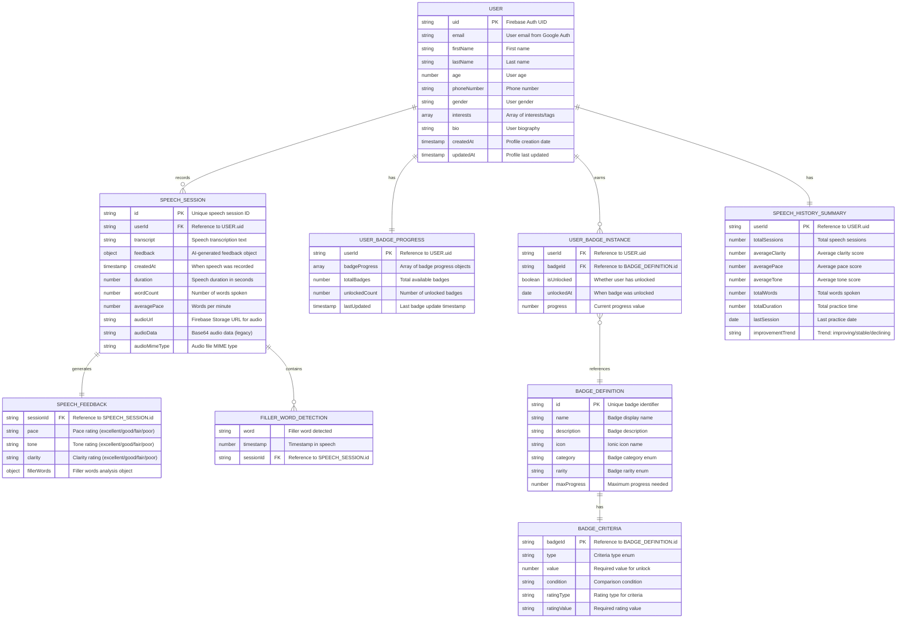

# StageReady Application - Entity Relationship Diagram (ERD)

## Overview
This ERD represents the complete data model for the StageReady Ionic application, a speech analysis and coaching platform that helps users improve their public speaking skills through AI-powered feedback and gamification.

## Entity Relationship Diagram

## Key Relationships

### Core Entities
1. **USER** - Central entity representing app users with complete profile information
2. **SPEECH_SESSION** - Individual speech practice sessions with audio and metadata
3. **SPEECH_FEEDBACK** - AI-generated analysis results for each speech session
4. **USER_BADGE_PROGRESS** - Overall badge tracking and statistics per user
5. **BADGE_DEFINITION** - Master badge definitions and metadata
6. **USER_BADGE_INSTANCE** - Individual badge instances per user with progress
7. **SPEECH_HISTORY_SUMMARY** - Aggregated statistics and trends

### Business Logic
- Users can record multiple speech sessions over time
- Each speech session generates detailed AI feedback (pace, tone, clarity, filler words)
- Badge system tracks user achievements across different categories
- Speech history summary provides analytics and improvement trends
- Audio files are stored in Firebase Storage with references in speech sessions

### Data Flow
1. User records speech → Creates SPEECH_SESSION entry
2. AI analyzes speech → Generates SPEECH_FEEDBACK data
3. Filler words detected → Creates FILLER_WORD_DETECTION records
4. Badge system evaluates criteria → Updates USER_BADGE_INSTANCE records
5. Summary statistics updated → Updates SPEECH_HISTORY_SUMMARY

## Entity Descriptions

### USER
The central entity storing user profile information including personal details, interests, and biographical information. Serves as the root for all user-related data.

### SPEECH_SESSION
Represents individual speech practice sessions. Contains the audio recording, transcript, timing data, and references to Firebase Storage for audio files.

### SPEECH_FEEDBACK
AI-generated analysis results for each speech session, including ratings for pace, tone, and clarity, plus filler word analysis.

### FILLER_WORD_DETECTION
Detailed tracking of specific filler words detected during speech analysis, with timestamps for precise location in the audio.

### USER_BADGE_PROGRESS
Overall badge statistics and progress tracking per user, including total badges and unlocked count.

### BADGE_DEFINITION
Master definitions of all available badges in the system, including metadata like icons, categories, and rarity levels.

### BADGE_CRITERIA
Rules and conditions that determine when badges are unlocked, including different types of criteria (speech count, ratings, profile completion).

### USER_BADGE_INSTANCE
Individual badge instances for each user, tracking progress and unlock status for specific badges.

### SPEECH_HISTORY_SUMMARY
Aggregated analytics including total sessions, average scores, improvement trends, and overall statistics.

## Enums and Constants

### BadgeCategory
- **PRACTICE** - Daily practice and consistency badges
- **PROGRESS** - Skill improvement and rating achievements  
- **PERFORMANCE** - Volume and speed-based achievements
- **SPECIAL** - Unique or time-based accomplishments
- **LEARNING** - Profile completion and exploration badges

### BadgeRarity
- **COMMON** - Easy to achieve, frequent badges
- **RARE** - Moderate difficulty, less frequent
- **EPIC** - Difficult to achieve, significant milestones
- **LEGENDARY** - Very difficult, major accomplishments

### Badge Criteria Types
- **speech_count** - Number of completed speech sessions
- **consecutive_days** - Days of consecutive practice
- **total_days** - Total unique practice days
- **rating_achievement** - Achieving specific rating levels
- **profile_completion** - Completing profile sections
- **time_based** - Time-specific achievements (e.g., night practice)

### Rating Values
- **excellent** - Highest rating level
- **good** - Above average performance
- **fair** - Average performance
- **poor** - Below average performance

## Technical Implementation Notes

- **Firebase Integration**: Uses Firestore for document storage and Firebase Storage for audio files
- **AI Analysis**: Integrates with Google Gemini API for speech analysis
- **Real-time Updates**: Badge progress updates in real-time as users complete activities
- **Audio Processing**: Supports multiple audio formats with MIME type tracking
- **Scalability**: Designed to handle multiple users with individual badge tracking
